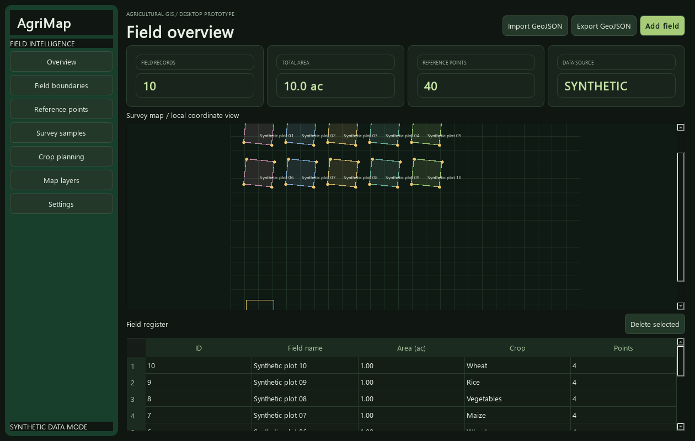

# AgriMap
Windows desktop GIS prototype for agricultural field records and synthetic survey geometry.

## Screenshots



The screenshot uses the included synthetic sample dataset: 10 one-acre plots and 40 reference points.
## Features
- PySide6 desktop interface with dark-green navigation and overview metrics.
- SQLite storage for field boundaries and reference points.
- Field register with area, crop and point counts.
- Local-coordinate map preview and 33 x 33 ft reference square.
- GeoJSON polygon import/export.
- Optional seed data: 10 synthetic one-acre plots with four points each.

## Setup (Windows)
```powershell
py -3.13 -m venv .venv
.\.venv\Scripts\Activate.ps1
python -m pip install -r requirements.txt
python seed_demo.py
python app.py
```
Database: %USERPROFILE%\AgriMap\agrimap.sqlite3

## Tests
```powershell
python -m unittest discover -s tests -v
python -m py_compile app.py storage.py seed_demo.py
```

## Scope
This is a reconstruction from retained specifications, not recovered original source. Seed records are synthetic, not real drone surveys. The 33 x 33 ft square is a visual scale reference, not a georeferenced measurement. Drone imagery, orthomosaics, DEM processing and real survey validation are not implemented. Coordinates are stored in a local plane; this prototype is not a replacement for a full GIS workflow. GeoPandas, Rasterio, Shapely, GDAL and Matplotlib can be added in a later processing phase.
